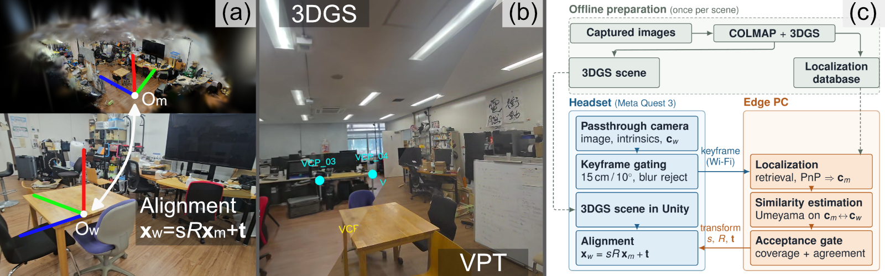

# VPTAligned3DGS

*[English](README.md) | 日本語*

Meta Quest 3 のビデオパススルー（VPT）と 3D Gaussian Splatting（3DGS）シーンを、**パススルーカメラ画像の再ローカライズによって自動で位置合わせする** MR アプリと、その計算をオフロードする PC サーバの実装です。

3DGS シーンを撮影した元の COLMAP 再構成に対してヘッドセットのカメラ画像を再ローカライズし、複数キーフレームのカメラ中心から Umeyama 法で Sim(3)（回転・並進・スケール）を推定して、3DGS をユーザーの実空間に重ね合わせます。スケールを含めて画像だけから解くため、マーカーや深度スキャンを必要としません。



*(a) 3DGS のモデル座標系 O<sub>m</sub> を Sim(3)（**x**<sub>w</sub> = s R **x**<sub>m</sub> + **t**）で Quest のワールド座標系 O<sub>w</sub> へ合わせる。(b) 位置合わせ後、3DGS（左）と VPT（右）で同じ検証点（VCP）が実物と重なる。(c) システム構成: ヘッドセットがキーフレームを Wi-Fi で送り、エッジ PC が再ローカライズ → Umeyama 法で Sim(3) 推定 → 受理ゲートを通ったものだけを返送する。*

---

## 1. リポジトリ構成

```
├─ unity/                          Quest 3 側 MR アプリ
│  ├─ Specification.md               設計書（なぜこの設計か・何を捨てたか）
│  ├─ ImplementationSpec.md          実装仕様書（確定値・座標数式。§10 がパラメータの真実）
│  ├─ OperationGuide.md              運用手順書（セットアップ・操作・実験・トラブルシュート）
│  ├─ package/                       aras-p UnityGaussianSplatting v1.1.1（MIT・同梱）
│  └─ projects/VPTAligned3DGS/       Unity プロジェクト本体
│     └─ Assets/Scripts/             位置合わせ・UDP 通信・実験制御
├─ server/                          PC 側（受信サーバ ＋ CV 再ローカライズ）
│  ├─ run.py                         Windows: UDP 受信・Sim(3) 返送・GUI
│  ├─ vptserver/cv/                  WSL2: hloc 再ローカライズ・Sim(3) 推定・品質ゲート
│  ├─ analysis/                      評価実験の集計スクリプト
│  └─ tests/                         純粋計算・プロトコル整合のテスト
├─ CLAUDE.md                       開発の作業規約（AI コーディングエージェント向け）
├─ LICENSE                         MIT
└─ THIRD-PARTY-NOTICES.md          third-party ライセンス（**商用化時の制約を含む**）
```

### 文書の読み方

| 知りたいこと | 文書 |
|---|---|
| **なぜこの設計か**・検討して採らなかった案・評価方法 | [`unity/Specification.md`](unity/Specification.md) |
| **確定値**・座標変換の数式・通信プロトコル・パラメータ一覧 | [`unity/ImplementationSpec.md`](unity/ImplementationSpec.md) |
| **どう動かすか**（セットアップ・コントローラ操作・実験手順・トラブルシュート） | [`unity/OperationGuide.md`](unity/OperationGuide.md) |
| PC サーバの詳細（プロトコル・CV パイプライン・解析スクリプト） | [`server/README.md`](server/README.md) |

`unity/LICENSE.md` と `unity/docs/` は同梱している aras-p UnityGaussianSplatting のもので、本プロジェクトの文書ではありません（MIT 遵守のため保持しています）。

---

## 2. 同梱していないもの

リポジトリにはコードと文書のみを含めています。以下は別途用意してください。

| 対象 | 理由 | 入手・生成方法 |
|---|---|---|
| **3DGS モデル**（`.ply` と変換済みアセット） | 数百 MB〜数 GB | 自前の `.ply` を用意し、Unity Editor の `Tools > Gaussian Splats > Create GaussianSplatAsset` で変換して `Assets/3DGSModel/` に配置。`GSTestScene` の `GaussianSplatRenderer` に割り当てる |
| **COLMAP シーン**（`server/scene_data/`） | 1 シーンあたり 1〜7 GB | 3DGS の学習に使った COLMAP 再構成（`sparse/0` ＋ `images/`）をそのまま置く |
| **hloc**（`server/Hierarchical-Localization/`） | 別リポジトリ | `cd server && git clone --recursive https://github.com/cvg/Hierarchical-Localization` |
| **実験の受信データ**（`server/received/`） | 実行時に自動生成 | `run.py` が起動ごとに `session_<時刻>/` を作成 |
| **Final IK / アバター** | Unity Asset Store の有償アセットで再配布不可 | 位置合わせの本筋には不要。使う場合は別途購入して `Assets/Plugins/RootMotion/` に配置 |

---

## 3. セットアップ

### 3.1 Quest 3 側（Unity）

前提: **Unity 6000.3.10f1** / URP（Render Graph Compatibility Mode Off）/ **Graphics API = Vulkan** / **OpenXR Render Mode = Multi-Pass**（aras-p v1.1.1 は Single Pass Instanced 非対応）/ Horizon OS v81 以降・MRUK v81 以降（Passthrough Camera Access の要件）。

1. `unity/projects/VPTAligned3DGS/` を Unity Hub で開く（パッケージは `manifest.json` から自動解決。3DGS パッケージは `file:../../../package` で `unity/package/` を参照）
2. `.ply` を変換して `Assets/3DGSModel/` に置き、`GSTestScene` の `GaussianSplatRenderer` に割り当てる
3. `GaussianSplatURPFeature` が **PC・Mobile 両方の URP Renderer** に付いていることを確認（片方だけだと実機で描画されない）
4. Build Profiles で Android / ARM64 / IL2CPP に切り替えてビルド

権限は `horizonos.permission.HEADSET_CAMERA` のみ（`Assets/Plugins/Android/AndroidManifest.xml` に記載済み）。

### 3.2 PC 側

**重い CV は WSL2(Ubuntu)+CUDA で動かします。** pycolmap は Windows ネイティブで `reconstruction.rigs` アクセス時にクラッシュするためです。UDP 受信・Sim(3) 返送・GUI は Windows 側の `run.py` が担当し、両者は共有フォルダ（`/mnt/c`）経由で疎結合に動きます。

```bash
# Windows 側
pip install -r server/requirements.txt

# WSL2 側（CUDA 環境）
pip install -r server/requirements-cv.txt
cd server && git clone --recursive https://github.com/cvg/Hierarchical-Localization
```

ポート: データ 50000（Quest→PC） / ビーコン 50001（PC→LAN ブロードキャスト） / 結果 50002（PC→Quest）。
AP がブロードキャストを遮断する環境では、Quest 側 `UDPManager.manualIPAddress` に PC の IP を設定してください。

---

## 4. 実行手順

```bash
# 0) シーンごとに一度（WSL2/GPU）: 再ローカライズ DB の構築
python -m vptserver.cv.hloc_db --scene scene_data/<name>

# 1) Windows: 受信・返送・GUI（起動ごとに received/session_<時刻>/ と cv.json を生成）
python run.py

# 2) WSL2: 最新セッションを自動追従し、N 枚ごとに Sim(3) を更新
python -m vptserver.cv.localize
```

3. Quest でアプリを起動し、**部屋を歩き回りながら**左グリップでキーフレームを送信します。独立に解かれた Sim(3) が連続して一致すると確定（ロック）し、以後は空間アンカーに永続化されます。

**精度は「どれだけ部屋を歩いたか」でほぼ決まります。** カメラ中心が一直線・同一平面に並ぶと Sim(3) が退化し、残差が小さいまま誤った解に落ちます（詳細と対策は [`unity/Specification.md`](unity/Specification.md) §6）。

---

## 5. 評価実験と解析

Quest 側 `Assets/Scripts/Experiment/` に実験制御・検証点（CP）の測量・先端校正・トラッキング原点の監視を実装しています。実機での作業は「一定時間歩き回る」だけで、精度と収束の曲線は保存済みキーフレームからオフラインで再構成します。

```bash
python -m analysis.check_tracking      # 先に必ず実行（原点が動いた試行の検出）
python -m analysis.experiment_report   # 主結果（試行ごとに姿勢を解き直して CP と突き合わせ）
python -m analysis.accuracy_vs_time    # 1 試行の収束曲線
```

純粋計算部のテスト:

```bash
cd server
python -m tests.test_geometry
python -m tests.test_gates
python -m tests.test_alignment_gates
```

---

## 6. ライセンス

本プロジェクト自体（`unity/projects/VPTAligned3DGS/Assets/Scripts/`, `server/`, 設計文書）は [MIT License](LICENSE)（© 2026 Ota, The University of Tokyo）です。

**依存する第三者ソフトウェアには商用化の制約があります。** 特徴点抽出の **SuperPoint** と画像検索の **NetVLAD** は研究/非商用ライセンスのため、現構成は学術研究・論文用途では利用可能ですが、そのまま商用製品には組み込めません。詳細は [THIRD-PARTY-NOTICES.md](THIRD-PARTY-NOTICES.md) を参照してください。
