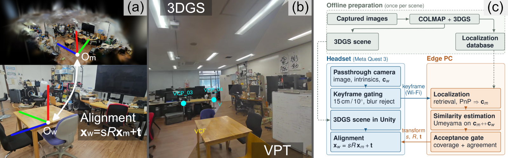

# VPTAligned3DGS

*English | [日本語](README.ja.md)*

**Automatic alignment of a 3D Gaussian Splatting (3DGS) scene with the video passthrough (VPT) of a Meta Quest 3**, using visual relocalization of the headset's passthrough camera images — plus the PC server that offloads the computation.

The headset's camera images are relocalized against the **COLMAP reconstruction that the 3DGS scene was trained from**. Camera centers from several keyframes are then matched against the corresponding Quest world positions, and a Sim(3) transform (rotation, translation and **scale**) is estimated with Umeyama's method, placing the 3DGS overlay onto the user's real room. Because the scale is solved from the images themselves, **no fiducial markers and no depth scanning are required**.



*(a) The 3DGS model frame O<sub>m</sub> is aligned to the Quest world frame O<sub>w</sub> by a Sim(3) transform (**x**<sub>w</sub> = s R **x**<sub>m</sub> + **t**). (b) After alignment, the same check point (VCP) coincides with the real object in both the 3DGS render (left) and the passthrough view (right). (c) System architecture: the headset streams keyframes over Wi-Fi; the edge PC relocalizes them, estimates the Sim(3) with Umeyama's method, and returns only solutions that pass the acceptance gate.*

---

## 1. Repository layout

```
├─ unity/                          MR application (Quest 3)
│  ├─ Specification.md               Design rationale — why this approach, what was rejected
│  ├─ ImplementationSpec.md          Implementation contract — fixed values, coordinate math (§10 = parameters)
│  ├─ OperationGuide.md              How to run it — setup, controls, experiments, troubleshooting
│  ├─ package/                       aras-p UnityGaussianSplatting v1.1.1 (MIT, vendored)
│  └─ projects/VPTAligned3DGS/       Unity project
│     └─ Assets/Scripts/             Alignment, UDP transport, experiment control
├─ server/                          PC side (receiver + CV relocalization)
│  ├─ setup_windows.bat              One-time PC setup (double-click): Python, WSL2, CV env, firewall
│  ├─ start_experiment.bat / start_demo.bat   Start the server (and the WSL2 CV worker)
│  ├─ run.py                         Windows: UDP receive, Sim(3) reply, GUI, starts the CV worker
│  ├─ vptserver/cv/                  WSL2: hloc relocalization, Sim(3) estimation, quality gates
│  ├─ analysis/                      Evaluation / aggregation scripts
│  └─ tests/                         Pure-computation and protocol-consistency tests
├─ CLAUDE.md                       Working conventions (for AI coding agents)
├─ LICENSE                         MIT
└─ THIRD-PARTY-NOTICES.md          Third-party licenses (**includes commercial-use restrictions**)
```

> **Note on language.** This README is in English; the detailed documents below are written in Japanese.

| If you want to know… | Read |
|---|---|
| **Why this design**, what alternatives were rejected, how it is evaluated | [`unity/Specification.md`](unity/Specification.md) |
| **Fixed values**, coordinate-transform math, wire protocol, parameter tables | [`unity/ImplementationSpec.md`](unity/ImplementationSpec.md) |
| **How to run it** — setup, controller mapping, experiment procedure, troubleshooting | [`unity/OperationGuide.md`](unity/OperationGuide.md) |
| PC server details — protocol, CV pipeline, analysis scripts | [`server/README.md`](server/README.md) |

`unity/LICENSE.md` and `unity/docs/` belong to the vendored aras-p UnityGaussianSplatting package, not to this project; they are retained to comply with its MIT license.

---

## 2. How it works

1. **Offline, once per scene.** SuperPoint features are extracted from the COLMAP database images and re-triangulated using the existing COLMAP poses, producing an SfM model in the *same coordinate frame as the `.ply`*. NetVLAD global descriptors are built for retrieval.
2. **Online, per keyframe.** The headset sends a downscaled JPEG together with the intrinsics `K`, the camera's world pose and a timestamp. The PC runs SuperPoint → NetVLAD retrieval → LightGlue matching → PnP+RANSAC, yielding the camera center in COLMAP coordinates.
3. **Aggregation.** Camera centers in COLMAP coordinates and in Quest world coordinates are fitted with Umeyama + RANSAC to obtain the Sim(3), which is sent back to the headset and applied to the splat root transform.

Two design points are worth highlighting:

- **The reflection is a constant, not an unknown.** COLMAP is right-handed and Unity is left-handed, and the aras-p importer reads PLY coordinates verbatim, so the model-to-world mapping requires a reflection — expressed as a **negative uniform scale** on the Unity transform. Letting the fit estimate the reflection freely produces a mirrored solution with *exactly the same residual* whenever the camera centers are coplanar (which happens whenever the user walks without changing head height). Fixing the handedness removes this failure mode entirely.
- **A small residual does not mean a correct solution.** Acceptance therefore requires (i) geometric gates on the *spatial distribution* of the camera centers, and (ii) **agreement between independently solved transforms** — not just a residual threshold. See `unity/Specification.md` §6.

**Accuracy is largely determined by how much the user walks.** Walking a wide arc across the room (~9 m) locks reliably with ~10 cm median error; standing still or walking a short straight line never converges — by design, since such configurations are degenerate.

---

## 3. What is *not* included

Only code and documentation are versioned here. The following must be supplied separately.

| Item | Why | How to obtain |
|---|---|---|
| **3DGS model** (`.ply` and converted assets) | Hundreds of MB to several GB | Supply your own `.ply`, convert it with `Tools > Gaussian Splats > Create GaussianSplatAsset` in the Unity Editor, place it under `Assets/3DGSModel/` and assign it to the `GaussianSplatRenderer` in `GSTestScene` |
| **COLMAP scene** (`server/scene_data/`) | 1–7 GB per scene | Drop in the COLMAP reconstruction used to train the 3DGS (`sparse/0` + `images/`) |
| **hloc** and the CV Python environment (WSL2) | Separate repository, several GB | Installed by `server\setup_windows.bat` (hloc pinned to commit `c13273b`, cloned to `~/hloc` inside WSL2) |
| **Experiment capture data** (`server/received/`) | Generated at runtime | `run.py` creates `session_<timestamp>/` on every launch |

---

## 4. Setup

### 4.1 Headset (Unity)

Requirements: **Unity 6000.3.10f1** / URP (Render Graph Compatibility Mode **off**) / **Graphics API = Vulkan** / **OpenXR Render Mode = Multi-Pass** (aras-p v1.1.1 does not support Single Pass Instanced) / Horizon OS v81+ and MRUK v81+ (required by Passthrough Camera Access).

1. Open `unity/projects/VPTAligned3DGS/` in Unity Hub. Packages resolve from `manifest.json`; the 3DGS package is referenced as `file:../../../package`.
2. Convert your `.ply`, place it under `Assets/3DGSModel/`, and assign it to the `GaussianSplatRenderer` in `GSTestScene`.
3. Verify that `GaussianSplatURPFeature` is added to **both the PC and the Mobile URP renderer** — with only one of them, nothing renders on device.
4. Switch the build profile to Android / ARM64 / IL2CPP and build.

The only permission required is `horizonos.permission.HEADSET_CAMERA` (already declared in `Assets/Plugins/Android/AndroidManifest.xml`).

### 4.2 PC

**The heavy CV runs under WSL2 (Ubuntu) + CUDA**, because pycolmap crashes on native Windows when `reconstruction.rigs` is accessed. UDP reception, the Sim(3) reply and the GUI stay on the Windows side in `run.py`; the two halves are loosely coupled through the shared `/mnt/c` filesystem. `run.py` starts and stops the WSL2 worker itself, so day-to-day use needs no Linux terminal.

Requirements: Windows 10/11 on the same LAN as the Quest; an **NVIDIA GPU is strongly recommended** (CPU works but takes minutes per alignment).

**Double-click `server\setup_windows.bat`** and answer its questions. It is safe to run again, and the first run takes 10–30 minutes. It will:

1. find (or offer to install) Python and create `server\.venv`;
2. find or install **Ubuntu-24.04 under WSL2** (a first-time WSL install may need a reboot and asks you to create a Linux user);
3. build the CV environment there with **pinned, tested versions** (torch 2.6.0+cu124, hloc `c13273b`, LightGlue `eb42fee`, `server/constraints-cv.txt`) and pre-download the model weights, so the PC also works offline at a venue;
4. allow inbound UDP 50000 in the Windows firewall — including on networks Windows classifies as *Public*, if you agree (the default firewall prompt leaves those blocked);
5. offer to build the relocalization database for each scene in `server/scene_data/`.

Details, manual steps and troubleshooting: [`server/README.md`](server/README.md).

Ports: 50000 data (Quest→PC) / 50001 discovery beacon (PC→LAN broadcast) / 50002 results (PC→Quest).
If the access point blocks broadcast traffic, set the PC's IP in `UDPManager.manualIPAddress` on the Quest side.

---

## 5. Running

| Purpose | Double-click (in `server\`) | Data folder |
|---|---|---|
| Build the database for a newly added scene (once per scene) | `build_scene_db.bat` | `scene_data/<name>/hloc/` |
| Evaluation experiment | `start_experiment.bat` | `received/` |
| Demo exhibition | `start_demo.bat` | `received_demo/` |

`start_*.bat` launches `run.py` (receive, reply, GUI; one `session_<timestamp>/` per launch), which in turn starts the CV worker in WSL2 and stops it when the window is closed. Arguments are passed through, e.g. `start_demo.bat --scene scene_data/<name>` when there are several scenes.

Then launch the app on the Quest and **walk around the room** while sending keyframes with the left grip. Once independently solved Sim(3) estimates agree consecutively, the alignment locks. In the demo mode (hold both thumbsticks for 3 s on the first screen) the alignment is also saved to spatial anchors and restored after a restart.

---

## 6. Evaluation

`Assets/Scripts/Experiment/` implements trial control, check-point surveying, controller-tip calibration and tracking-origin monitoring. On device, a trial consists of nothing but *walking around for a fixed duration*; the accuracy-versus-time curve is reconstructed offline from the stored keyframes.

```bash
python -m analysis.check_tracking      # Run first: detects trials where the world origin moved
python -m analysis.experiment_report   # Main result: re-solves the pose per trial and compares against check points
python -m analysis.accuracy_vs_time    # Convergence curve for a single trial
```

Tests for the pure-computation parts:

```bash
cd server
python -m tests.test_geometry
python -m tests.test_gates
python -m tests.test_alignment_gates
```

---

## 7. License

This project's own code and documentation (`unity/projects/VPTAligned3DGS/Assets/Scripts/`, `server/`, the design documents) are released under the [MIT License](LICENSE), © 2026 Ota, The University of Tokyo.

**Some third-party dependencies restrict commercial use.** The SuperPoint feature extractor and the NetVLAD image-retrieval model are distributed under research / non-commercial licenses, so the current configuration is usable for academic research and publication but **cannot be shipped in a commercial product as-is**. See [THIRD-PARTY-NOTICES.md](THIRD-PARTY-NOTICES.md) for the full list.
